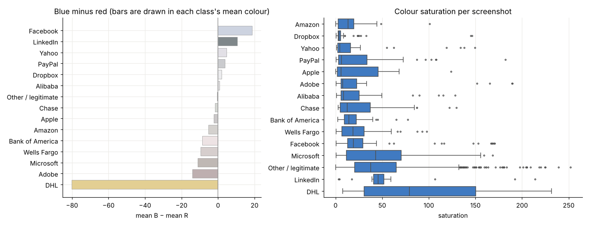
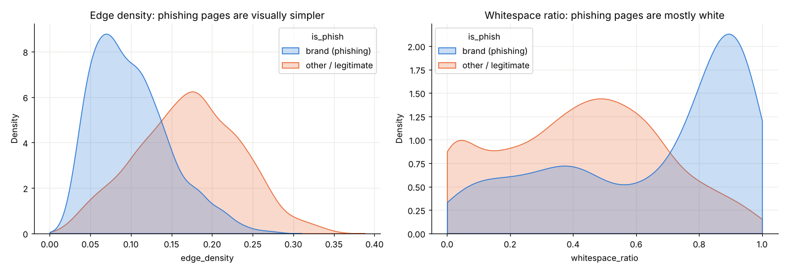

# Visual Phishing Detection: an end-to-end ML pipeline

An image classification pipeline that looks at a **screenshot of a web page** and predicts which of 14
heavily phished brands it imitates (PayPal, Microsoft, Facebook, DHL, …), or `other` when it copies
none of them. It covers data acquisition, cleaning, training, evaluation, a REST API, a web UI with
upload and retraining, Docker scaling behind a load balancer, and a Locust load test.

It extends my Intro to ML summative,
[phishing URL detection (ML vs DL)](https://github.com/mutaganzwa-desire/phishing-url-detection-ml-vs-deep-learning),
from the URL string to what the page **looks like**.

| | |
|---|---|
| **Video demo** | _YouTube link: add before submitting_ |
| **Live app** | _Deployed URL: add after deploying (see [Deployment](#deployment))_ |
| **Dataset** | [Phish-IRIS](https://data.mendeley.com/datasets/tk4fkswtj5) (2,849 screenshots, 15 classes, collected 2018) |
| **Model** | MobileNetV2 transfer learning (Keras), `models/phish_iris_mobilenetv2.h5` |
| **Notebook** | [`notebook/phishing_screenshot_pipeline.ipynb`](notebook/phishing_screenshot_pipeline.ipynb) |


---

## Project description

Phishing kits clone the visual identity of the brand they target: the logo, the colours, the login form.
Blocklists miss new phishing URLs, but a cloned page still *looks like* PayPal. This project trains a CNN
to recognise that look. Its output has two uses:

* **Brand identification:** "this page is imitating Microsoft".
* **Phishing score:** 1 − P(`other`), a binary phishing vs. legitimate signal.

### Results (held-out test set, 816 screenshots)

| metric | value |
|---|---|
| accuracy | **78.8%** |
| top-3 accuracy | **92.7%** |
| macro F1 / balanced accuracy | 0.649 / 0.613 |
| Cohen's kappa | 0.671 |
| phishing vs. other: precision / recall / F1 | 0.893 / 0.789 / 0.838 |
| phishing vs. other: ROC-AUC / average precision | **0.948** / 0.927 |

The notebook compares the deployed fine-tuned model with a frozen-backbone baseline (macro F1 0.579) and
reports per-class scores, the confusion matrix, ROC and PR curves, and the model's most confident mistakes.

**Data audit.** The original archive contains **400 exact duplicate files**, and **204 of its official test
images are copies of training images**. I removed the duplicates and grouped near-identical screenshots with
a perceptual hash. The data was then re-split (stratified, 67/33) so that no near-copy of a test image is
used for training. Scores are therefore lower than numbers reported on the leaky split, but they are honest.

### Feature visualizations (in the notebook and the UI)

1. **Class balance:** `other` is 56% of the data, and PayPal and Facebook are the most phished brands. This is
   why training uses class weights and the model is judged on macro F1.
2. **Colour:** phishing kits copy brand palettes. DHL pages are strongly yellow, Facebook and LinkedIn lean blue,
   and Adobe and Microsoft lean red. But many brands share "white page, blue button", so a CNN is needed to read
   logos and layout.
3. **Layout:** legitimate pages have about 1.6× the edge density (clutter) of phishing pages, while phishing
   pages are mostly white login forms. *A sparse white page with a famous logo* is the visual signature of a kit.

<p>
 
</p>

---

## Flood request simulation (Locust)

50 concurrent users, each sending a screenshot to `/predict` every 0.5–1.5 s for 60 s. The API ran
in **1, 2 and 4 Docker containers** (1 CPU each) behind an nginx load balancer
(`locust/run_scaling_test.sh`).

| containers | requests | failures | avg (ms) | median (ms) | p95 (ms) | p99 (ms) | max (ms) | req/s |
|---:|---:|---:|---:|---:|---:|---:|---:|---:|
| 1 | 358 | 0 | 6,076 | 6,600 | 7,700 | 12,000 | 14,662 | 6.1 |
| 2 | 673 | 0 | 2,843 | 2,900 | 3,900 | 4,400 | 5,133 | 11.4 |
| 4 | 1,503 | 0 | 749 | 750 | 1,200 | 1,400 | 1,630 | 25.4 |


**Interpretation.** One container handles about 6 predictions/s (about 150 ms of CPU each). At 50 users,
requests queue up and the median wait reaches 6.6 s. Doubling the containers roughly doubles throughput and
halves latency. With 4 containers the service keeps up with the load: median 0.75 s and **4.2× the
throughput**, with no failed requests at any size. Raw CSVs are in `locust/results/`.

---

## Features

| Requirement | Where |
|---|---|
| Predict one image | UI **Predict** tab · `POST /predict` |
| Model up-time | UI **Overview** tab · `GET /health` (uptime, version, request count, p50/p95 latency, container id) |
| Visualizations (3 features + interpretation) | UI **Data insights** tab · notebook section 4 |
| Bulk upload | UI **Upload & retrain** · `POST /upload` (many images + a label, or a `.zip` with one folder per class) |
| Trigger retraining | **Retrain now** button · `POST /retrain` · automatic once `RETRAIN_THRESHOLD` (30) uploads are waiting |
| Evaluation in production | UI **Model performance** tab · `GET /metrics` (metrics + version history) |

**How retraining works** (`src/model.py: retrain`)
1. Uploads are cleaned with the same preprocessing and saved to `data/uploads/<class>/`.
2. The production model is fine-tuned on `data/train` plus the uploads (warm start: under a minute on a 4-core machine, about 5 minutes in a 1-CPU container).
3. The candidate is evaluated on the fixed test set and **promoted only if macro F1 drops by no more than 0.01**.
   Every version is saved in `models/versions/` and logged in `models/registry.json`.
4. The uploads join `data/train`. Every API container sees the new `registry.json` on the shared volume and
   hot-reloads the model.

### API

| Method | Path | Description |
|---|---|---|
| GET | `/` | Web UI |
| GET | `/health` | Status, uptime, model version, latency stats |
| POST | `/predict` | form field `file`: one screenshot. Returns brand, confidence, top-3 and phishing score |
| POST | `/upload` | form fields `files` (images or `.zip`), optional `label` |
| POST | `/retrain` | start retraining (409 if one is running) |
| GET | `/retrain/status` | state and log of the current or last retrain |
| GET | `/metrics` | test metrics of the production model + version registry |
| GET | `/insights` | dataset feature statistics |
| GET | `/docs` | interactive OpenAPI docs |

```bash
curl -F "file=@screenshot.png" http://localhost:8080/predict
curl -F "files=@new_images.zip" http://localhost:8080/upload
curl -X POST http://localhost:8080/retrain
```

---

## Repository structure

```
phishing-screenshot-ml-pipeline/
├── README.md
├── notebook/
│   ├── phishing_screenshot_pipeline.ipynb   # preprocessing, training, evaluation, retraining
│   └── build_notebook.py                    # regenerates the notebook
├── src/
│   ├── preprocessing.py   # acquisition, audit, cleaning, tf.data, image features
│   ├── model.py           # model creation, training, evaluation, versioning, retraining
│   ├── prediction.py      # Predictor (hot-reloading) used by the API
│   ├── api.py             # FastAPI app
│   └── static/index.html  # web UI
├── data/
│   ├── train/<class>/     # 1,632 preprocessed 224×224 screenshots
│   ├── test/<class>/      # 816
│   └── uploads/           # new labelled data waiting for retraining
├── models/
│   ├── phish_iris_mobilenetv2.h5   # production model
│   ├── class_names.json, registry.json
│   └── versions/                   # every trained version
├── reports/               # metrics.json, data_audit.json, dataset_stats.json, figures/
├── locust/                # locustfile.py, run_scaling_test.sh, results/
├── deploy/                # nginx.conf, Hugging Face Space header
├── docs/                  # demo script, UI screenshots
├── Dockerfile, docker-compose.yml
└── requirements.txt, requirements-dev.txt
```

---

## Setup

### 1. Run locally with Python (3.11–3.13)

```bash
git clone https://github.com/mutaganzwa-desire/<repo-name>.git
cd <repo-name>
python -m venv .venv && source .venv/bin/activate      # Windows: .venv\Scripts\activate
pip install -r requirements-dev.txt
uvicorn src.api:app --port 8000
# open http://localhost:8000
```

The processed data and the trained model are in the repo, so no download is needed. To rebuild everything
from the raw archive: `python -m src.preprocessing` (downloads about 800 MB), then
`python -m src.model train`, or run the notebook top to bottom.

### 2. Run with Docker (one or many containers)

```bash
docker compose up -d --build                 # 1 API container + nginx, http://localhost:8080
docker compose up -d --scale api=4           # scale to 4 containers
```

### 3. Reproduce the load test

```bash
pip install -r requirements-dev.txt
bash locust/run_scaling_test.sh 50 60s       # 50 users, 60 s, at 1, 2 and 4 containers
# or interactively: locust -f locust/locustfile.py --host http://localhost:8080  ->  http://localhost:8089
```

---

## Deployment

**Recommended: Hugging Face Spaces (Docker, free).** The free tier gives 2 vCPU and 16 GB RAM, which TensorFlow
needs. Render's and Railway's free tiers (512 MB) are too small.

1. Create a Space at <https://huggingface.co/new-space>, choose **Docker → Blank** and **CPU basic (free)**.
2. Push this repository to the Space, using the header file in `deploy/huggingface/` as the Space's README:
   ```bash
   git clone https://huggingface.co/spaces/<hf-user>/<space-name> space
   rsync -a --exclude .git --exclude README.md ./ space/
   cp deploy/huggingface/README.md space/README.md
   cd space && git lfs install && git lfs track "*.h5" "*.jpg" && git add -A && git commit -m "Deploy" && git push
   ```
3. The Space builds the Dockerfile and serves the app at `https://<hf-user>-<space-name>.hf.space`.
   Put that URL in the table at the top of this README.

Other options: Google Cloud Run or Azure Container Apps work with the same image (`--memory 2Gi`). On those, mount
a persistent volume at `/app/models` and `/app/data`, or retrained versions are lost when the instance restarts.

---

## Limitations and next steps

* Phish-IRIS dates from 2018. Brand designs and phishing kits change, so the model should be re-evaluated on
  newly collected screenshots, as recommended in my URL project.
* Part of the signal is "sparse login page vs. busy content page", so a real login page of an unlisted brand
  can get a high phishing score. Combining this model with the URL model would address that.
* The weakest classes (LinkedIn, Microsoft, Apple) have the fewest or most varied examples. The upload and
  retrain loop is designed to fix exactly that.

**Author:** Mutaganzwa Gift Desire · African Leadership University, BSE · November 2026
