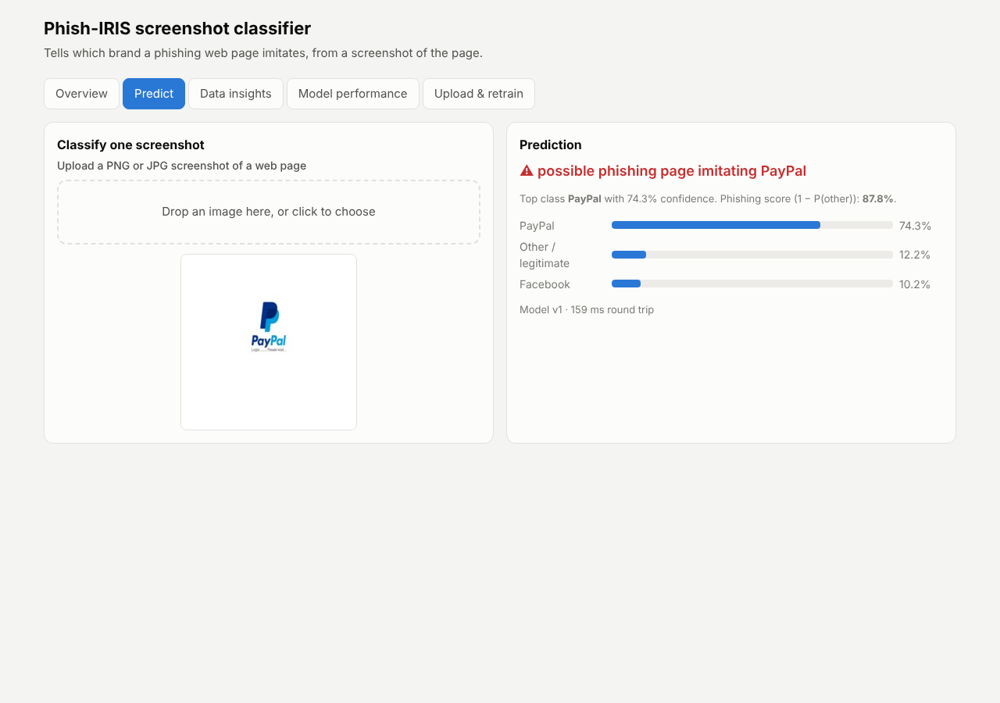
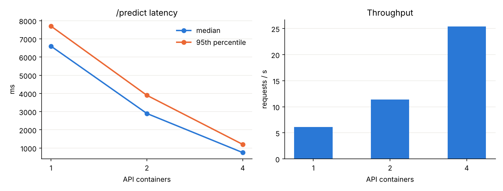

# Visual Phishing Detection: an ML pipeline

A web app that looks at a **screenshot of a web page** and tells you which brand it is pretending to be
(PayPal, Microsoft, Facebook, DHL and 10 others), or `other` if it copies none of them.

It continues my Intro to ML project,
[phishing URL detection](https://github.com/mutaganzwa-desire/phishing-url-detection-ml-vs-deep-learning):
that one read the web address, and this one reads what the page **looks like**.

| | |
|---|---|
| **Live app** | https://phish-iris-classifier.onrender.com |
| **Video demo** | https://youtu.be/_0O0BO16lvg |
| **Notebook** | [`notebook/phishing_screenshot_pipeline.ipynb`](notebook/phishing_screenshot_pipeline.ipynb) |
| **Model** | `models/phish_iris_mobilenetv2.h5` (MobileNetV2, fine-tuned) |
| **Dataset** | [Phish-IRIS](https://data.mendeley.com/datasets/tk4fkswtj5): 2,849 screenshots, 15 classes |

---

## How to use the live app

Open https://phish-iris-classifier.onrender.com. The free server sleeps when nobody is using it, so the first
visit can take about a minute to load.

### 1. Overview
Shows that the model is **online**, how long it has been running (**uptime**), which **model version** is live,
and how fast recent predictions were.

### 2. Predict
1. Click **Predict**.
2. Drop a screenshot of a web page into the box, or click it to choose a file (PNG or JPG).
3. The app shows:
   - the **verdict**, e.g. *"possible phishing page imitating PayPal"*, or *"legitimate / unknown brand"*;
   - the model's **confidence** and its **top 3 guesses**;
   - a **phishing score** from 0 to 1 (how likely the page is copying one of the brands).

Want to try it? Use any image from `data/test/<brand>/` in this repo, e.g. `data/test/dhl/dhl_19_png.jpg`.



### 3. Data insights
Three charts that explain the dataset, each with a short explanation:
- **Class balance:** how many screenshots each brand has.
- **Colour:** fake pages copy the brand's colours (DHL is yellow, Facebook is blue).
- **Layout:** fake pages are plain white login forms, while real websites are busy.

It also shows one example screenshot per brand.

### 4. Upload & retrain
1. **Upload new data.** Either choose several images and pick their brand from the dropdown, or upload a
   **.zip** with one folder per brand (e.g. `amazon/`, `linkedin/`). Folder names must match the brand names in the
   dropdown.
2. Each image is cleaned the same way as the training data (converted to RGB, resized to 224×224) and saved, waiting
   for retraining. The page tells you how many images are waiting.
3. Click **Retrain now**. Retraining also starts **automatically** once 30 new images are waiting.
4. The model is updated **starting from the current trained model**, then tested on the same test images.
   It only replaces the live model if it scores **at least as well**. The log shows the result
   (about 3–4 minutes on the free server).

### 5. Model performance
Shows the live model's test scores (accuracy, F1 and more), its training curves, the score for each brand, a
confusion matrix, and a **Model versions** table listing every retrain and whether it was promoted.

> The free server resets its storage when it restarts, so uploaded images and new model versions are cleared,
> and the app goes back to the original model.

---

## Results

Tested on 816 screenshots the model never saw during training:

| Metric | Score |
|---|---|
| Accuracy | **78.8%** |
| Right brand in top 3 guesses | **92.7%** |
| Precision / Recall / F1 (average over brands) | 0.728 / 0.613 / 0.649 |
| Loss (log loss) | 0.774 |
| Fake vs. real page: F1 / ROC-AUC | 0.838 / **0.948** |

**How the model was built** (details in the notebook):
- **Pre-trained MobileNetV2**, trained in two rounds: first the final layer, then fine-tuning of the top layers.
- Adam optimizer, early stopping, learning-rate reduction, dropout, L2 regularization, class weights and
  light image augmentation.
- **Data cleaning:** the original dataset had 400 duplicate images, and 204 of its test images were copies of
  training images. I removed them and split the data so near-identical screenshots never appear in both
  training and test. The scores above are therefore honest ones.

---

## Load test (Locust)

50 users sending screenshots to the app at the same time for 60 seconds, with 1, 2 and 4 Docker containers
behind a load balancer:

| Containers | Requests | Failures | Average wait | Median wait | 95% of requests under | Requests per second |
|---:|---:|---:|---:|---:|---:|---:|
| 1 | 358 | 0 | 6.1 s | 6.6 s | 7.7 s | 6.1 |
| 2 | 673 | 0 | 2.8 s | 2.9 s | 3.9 s | 11.4 |
| 4 | 1,503 | 0 | 0.75 s | 0.75 s | 1.2 s | 25.4 |



More containers means shorter waits: going from 1 to 4 containers cut the median wait from 6.6 s to 0.75 s
and handled 4 times as many requests, with no failures. Raw results are in `locust/results/`.

---

## Setup

### Run locally (Python 3.11–3.13)
```bash
git clone https://github.com/mutaganzwa-desire/phishing-screenshot-ml-pipeline.git
cd phishing-screenshot-ml-pipeline
python -m venv .venv && source .venv/bin/activate      # Windows: .venv\Scripts\activate
pip install -r requirements-dev.txt
uvicorn src.api:app --port 8000                        # open http://localhost:8000
```
The cleaned data and trained model are already in the repo. To rebuild from scratch, run the notebook top to bottom.

### Run with Docker
```bash
docker compose up -d --build              # app + load balancer at http://localhost:8080
docker compose up -d --scale api=4        # run 4 copies of the app
bash locust/run_scaling_test.sh 50 60s    # repeat the load test (needs requirements-dev.txt)
```

### Deploy on Render (free)
The live app runs on Render as a Docker container built from `Dockerfile.render`. This is a lighter version of the
same model (TFLite), so it fits in the free tier's 512 MB of memory. It gives the same predictions, and retraining
on Render re-learns the model's final layer.
1. Sign in at https://dashboard.render.com with GitHub.
2. Click **New → Blueprint**, choose this repo, and click **Deploy Blueprint** (Render reads `render.yaml`).

---

## API (for developers)

Interactive docs: https://phish-iris-classifier.onrender.com/docs

| Method | Path | What it does |
|---|---|---|
| POST | `/predict` | classify one screenshot (`file`) |
| POST | `/upload` | upload images (`files`, optional `label`) or a `.zip` of brand folders |
| POST | `/retrain` | start retraining |
| GET | `/retrain/status` | progress and result of the last retrain |
| GET | `/health` | status, uptime, model version |
| GET | `/metrics` | test scores and model versions |
| GET | `/insights` | data for the charts |

---

## Repository structure

```
phishing-screenshot-ml-pipeline/
├── README.md
├── notebook/phishing_screenshot_pipeline.ipynb   # preprocessing, training, evaluation, retraining
├── src/
│   ├── preprocessing.py    # getting, cleaning and preparing images
│   ├── model.py            # building, training, testing and retraining the model
│   ├── prediction.py       # making predictions
│   ├── lite.py             # lighter model version used on Render
│   ├── api.py              # the web app and API
│   └── static/index.html   # the user interface
├── data/train/, data/test/ # 1,632 / 816 cleaned screenshots, one folder per brand
├── models/                 # trained model (.h5), lighter version (.tflite) and version history
├── reports/                # metrics, data audit, charts
├── locust/                 # load test script and results
├── Dockerfile, Dockerfile.render, docker-compose.yml, render.yaml
└── requirements.txt, requirements-dev.txt, requirements-render.txt
```

---

## Limitations

- The dataset is from 2018, so newer phishing pages may look different.
- A real login page of a brand the model doesn't know can still get a high phishing score.
- LinkedIn, Microsoft and Apple are the weakest brands because they have the fewest examples. Uploading more
  of them and retraining is the way to improve them.

**Author:** Mutaganzwa Gift Desire · African Leadership University, BSE · November 2026
